<picture><source media="(prefers-color-scheme: dark)" srcset="assets/hero-dark.svg"></picture>

<picture><source media="(prefers-color-scheme: dark)" srcset="assets/social-l-dark.svg"></picture><a href="https://discord.com/@slimsystem"><picture><source media="(prefers-color-scheme: dark)" srcset="assets/social-1-dark.svg"></picture></a><picture><source media="(prefers-color-scheme: dark)" srcset="assets/social-r-dark.svg"></picture>

<picture><source media="(prefers-color-scheme: dark)" srcset="assets/about-dark.svg"></picture>

<picture><source media="(prefers-color-scheme: dark)" srcset="assets/stack-dark.svg"></picture>

<a href="https://github.com/SLIM-TECH/SLIM-TECH"><picture><source media="(prefers-color-scheme: dark)" srcset="assets/project-slim-tech-dark.svg"></picture></a>&nbsp;<a href="https://github.com/SLIM-TECH/anibot2"><picture><source media="(prefers-color-scheme: dark)" srcset="assets/project-anibot2-dark.svg"></picture></a>

<a href="https://github.com/SLIM-TECH/GDI-VIRUS"><picture><source media="(prefers-color-scheme: dark)" srcset="assets/project-gdi-virus-dark.svg"></picture></a>&nbsp;<a href="https://github.com/SLIM-TECH/PLS-PYTHON-LAZY-SCRIPT-"><picture><source media="(prefers-color-scheme: dark)" srcset="assets/project-pls-python-lazy-script-dark.svg"></picture></a>

<picture><source media="(prefers-color-scheme: dark)" srcset="assets/stats-dark.svg"></picture>

<picture><source media="(prefers-color-scheme: dark)" srcset="assets/streak-dark.svg"></picture>

<picture><source media="(prefers-color-scheme: dark)" srcset="assets/wave-dark.svg"></picture>

<a href="https://slimsystemportfolio.vercel.app/"><picture><source media="(prefers-color-scheme: dark)" srcset="assets/button-1-dark.svg"></picture></a>

<a href="https://metawka.github.io/expressive-profile/?from=SLIM-TECH"><picture><source media="(prefers-color-scheme: dark)" srcset="assets/credit-dark.svg"></picture></a>

